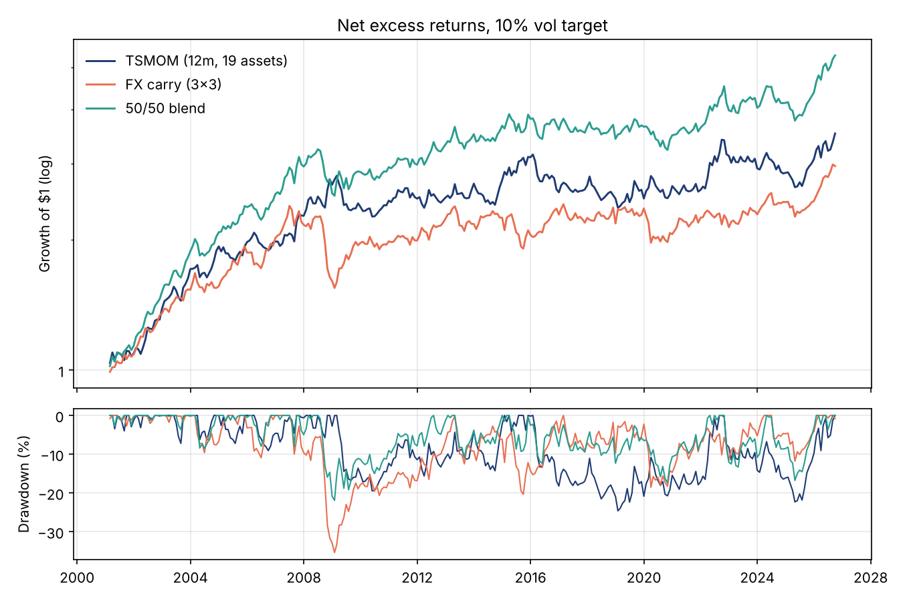
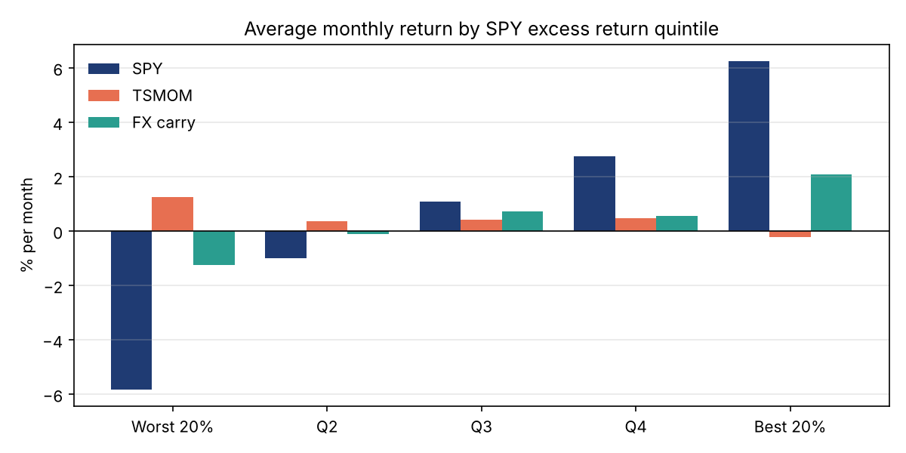

# macro-backtester

A small, vectorised backtesting library and a study of two classic systematic macro strategies:

* **Time-series momentum (TSMOM)**, following Moskowitz, Ooi and Pedersen (2012): long assets that have gone up over the past year, short the ones that went down, sized by volatility.
* **G10 FX carry**: long the three highest yielding currencies, short the three lowest.

The universe is 10 ETFs (equities, Treasuries, TIPS, gold, silver, broad commodities) and 9 G10 currencies against the USD. Everything runs on monthly data, is net of transaction costs and uses a one-month execution lag.



## Headline results (Feb 2001 to Sep 2026, net of costs, 10% vol target)

| Strategy | Return | Vol | Sharpe | Gross Sharpe | Max DD | Turnover (x/yr) | Cost (/yr) | Skew |
| --- | ---: | ---: | ---: | ---: | ---: | ---: | ---: | ---: |
| TSMOM (12m, 19 assets) | 5.0% | 10.6% | 0.51 | 0.56 | -24.6% | 11.4 | 0.48% | 0.26 |
| FX carry (3x3) | 4.3% | 10.2% | 0.47 | 0.48 | -35.4% | 3.5 | 0.11% | -0.69 |
| 50/50 blend | 6.7% | 10.2% | 0.69 | 0.73 | -21.9% | 10.0 | 0.40% | -0.26 |

The two strategies are roughly uncorrelated (-0.07), which is why the blend has a higher Sharpe than either one. The full set of tables is in [`results/results.md`](results/results.md).

## What I found

**Momentum is crisis alpha, carry is the opposite.** Sorting months by the S&P 500's return, TSMOM made +1.3% a month on average in the worst fifth of equity months, while carry lost 1.3%. That is the "smile" from the trend following literature: trend strategies are short risk by the time a sell-off is well underway, and carry is a short volatility trade that pays off in calm markets and crashes in panics (its worst drawdown, -35%, is the 2008 unwind).



**Momentum's returns are very uneven over time.** Sharpe 1.21 from 2001 to 2008, roughly zero from 2009 to 2019 and 0.51 since 2020. The 2010s were a decade of central-bank-suppressed volatility and sharp reversals, which is known to be a bad environment for trend.

**Picking the lookback walk-forward made things worse.** Choosing the lookback each January by the best trailing five-year Sharpe gave a net Sharpe of 0.34 against 0.51 for just holding 12 months fixed. The selection jumps around (3m in 2011-15, 24m in 2016-18) and keeps chasing whatever worked recently. Any lookback from 9 to 18 months gives similar results, so the honest conclusion is that the parameter isn't something to optimise.

**Execution speed matters more than costs.** Doubling the assumed costs only takes the Sharpe from 0.51 to 0.47, but trading one month later takes it to 0.33. The signal decays quickly.

**A bug that changed the answer.** The first version estimated the portfolio covariance from complete rows only. When a new ETF entered the window, there weren't enough complete rows, the ex-ante vol came back NaN and the whole book went flat for most of 2003-2005. That cut the TSMOM Sharpe roughly in half. I found it by checking against a ten-line independent implementation, and the fix (pairwise covariance) has a regression test.

## How it works

```
src/macrobt/
  engine.py       run_backtest: lagged weights, drift between rebalances, costs on turnover
  signals.py      tsmom_weights, carry_weights, EWMA volatility
  portfolio.py    ex-ante volatility, volatility targeting, blending
  walkforward.py  out-of-sample parameter selection
  metrics.py      Sharpe, Sortino, drawdown, Calmar, hit rate
  data/           FRED and Yahoo Finance loaders, monthly panel construction
scripts/
  download_data.py
  run_study.py    writes results/ and figures/
```

**Engine.** Weights decided at the end of month t earn the returns of month t+1. Between rebalances positions drift with their own returns, so the trade at each rebalance is measured against the drifted book, not last month's target. Costs are charged per asset class on that turnover: 5bp one way for equity and bond ETFs, 10bp for commodity ETFs and 3bp for G10 FX.

**Returns.** ETF returns come from dividend-adjusted closes minus the 3-month T-bill rate. FX excess returns are the spot move plus the interest differential, `S(t)/S(t-1) - 1 + (i_foreign - i_US)/12`, using OECD 3-month interbank rates from the previous month. By covered interest parity this is close to the return on a rolled one-month forward.

**TSMOM.** Each asset gets `sign(12m return) x 40% / sigma`, where sigma is an EWMA volatility estimate, and the book is divided by the number of active assets. The whole portfolio is then scaled to 10% ex-ante volatility using a 36-month pairwise covariance, with gross leverage capped at 4x.

**Carry.** Rank the 9 currencies by rate differential each month, +1/3 in the top three and -1/3 in the bottom three, then scale to 10% vol.

## Run it

```bash
git clone https://github.com/YDawoud7/macro-backtester
cd macro-backtester
python -m venv .venv && source .venv/bin/activate
pip install -e ".[dev]"
pytest -q
python scripts/download_data.py    # FRED and Yahoo Finance, saved to ./data
python scripts/run_study.py
```

```python
from macrobt.engine import run_backtest
from macrobt.signals import tsmom_weights
from macrobt.portfolio import vol_target

w = vol_target(tsmom_weights(returns, lookback=12), returns, target=0.10)
res = run_backtest(returns, w, cost_bps=5)
res.summary()
```

## Limitations

* ETFs stand in for futures. They start between 1993 and 2006, so the multi-asset sample begins in 2001 and the early years have fewer assets. Futures data would extend the history and add markets like Bunds, JGBs and energy.
* Monthly data. A daily version would allow faster vol estimates and intra-month risk management.
* OECD interbank rates are monthly averages, not month-end fixings, and the euro area and UK series currently stop in January 2026, so the last few months carry the January print forward.
* There's no market impact model. At these turnover levels and in these markets that's a reasonable simplification, but it would not be at larger size.

## Data

* FRED: H.10 daily exchange rates (`DEXUSEU`, `DEXJPUS`, ...), OECD 3-month interbank rates (`IR3TIB01xxM156N`) and the 3-month T-bill (`TB3MS`).
* Yahoo Finance: adjusted closes for SPY, EFA, EEM, EWJ, IEF, TLT, TIP, GLD, SLV and DBC.

Raw data is downloaded locally and not committed.

## Reference

Moskowitz, T., Ooi, Y. H. and Pedersen, L. H. (2012). Time series momentum. *Journal of Financial Economics*, 104(2), 228-250.
